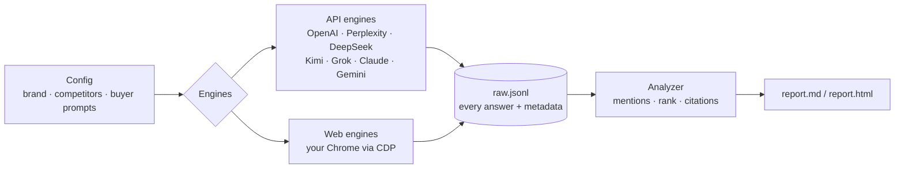

<div align="center">


# citeshine-audit

**Find out whether ChatGPT recommends your product or your competitors, and read exactly what it says about you.**

*Make AI see you. · 让 AI 看见你*

[](LICENSE) [](#quickstart) [](#quickstart) [](#what-it-measures)

**English** · [简体中文](README.zh-CN.md) · [Free audit](https://citeshine.com) · [Sample report](docs/examples/citeshine-chatgpt-web-2026-10-13.md)

</div>

---

## Your buyers stopped googling. They ask AI.

Questions like "Which tool should I use for X?" now go to ChatGPT, Perplexity, DeepSeek, Kimi and Gemini. The engine answers with a short list. **If you're not on that list, you don't exist for that buyer.** No click, no visit, nothing in your analytics.

Worse, the engine may describe you wrongly: an old product, a previous owner of your domain, a stale complaint. Most teams have no idea what these engines say about them. `citeshine-audit` asks the questions your buyers ask, saves every answer, and counts who gets mentioned, ranked and cited.

### We ran it on ourselves first

Honest dogfooding, day 0, real data ([full report](docs/examples/citeshine-chatgpt-web-2026-10-13.md)):

- **0 / 11.** On 11 generic buyer questions ("best GEO agencies", "tools to track brand visibility in ChatGPT", ...), ChatGPT never mentioned Citeshine.
- **Mistaken identity.** Asked about us by name, ChatGPT described citeshine.com as an **old Shopify phone-case store**, citing an old Merchant Genius listing for the domain.

That's the gap this tool shows you, and it's our baseline. We're building in public: we'll re-test Citeshine on the same prompts and publish each result next to this day-0 run, good or bad.

<p align="center"></p>

## What it measures

| Metric | What you get |
|---|---|
| **Mention rate** | Share of answers that mention your brand (name, aliases, domain), per engine and per prompt |
| **Recommendation rank** | Order of first mention among tracked brands, plus position in numbered or bulleted lists |
| **Share of voice** | How often you appear compared with each competitor |
| **Cited sources** | Which domains the engine cites, and whether your own site is among them |
| **Raw answers** | Every answer saved to `raw.jsonl` with timestamp, engine, model and prompt, so runs are reproducible and auditable |

Every number is a raw count with its sample size. Nothing is extrapolated. Answers that mention you are excerpted in the report so a person can check them for accuracy; the full text stays in `raw.jsonl`.

## Supported engines

| Engine | Type | Status |
|---|---|---|
| `openai` (Responses API + web search) | API · `OPENAI_API_KEY` | Implemented, untested end to end; bring your own key |
| `perplexity` | API · `PERPLEXITY_API_KEY` | Implemented, untested end to end; bring your own key |
| `deepseek` | API · `DEEPSEEK_API_KEY` | Implemented, untested end to end; bring your own key |
| `kimi` (Moonshot) | API · `MOONSHOT_API_KEY` | Implemented, untested end to end; bring your own key |
| `grok` | API · `XAI_API_KEY` | Implemented, untested end to end; bring your own key |
| `claude` (web search) | API · `ANTHROPIC_API_KEY` | Implemented, untested end to end; bring your own key |
| `gemini` (Search grounding) | API · `GEMINI_API_KEY` | Implemented, untested end to end; bring your own key |
| `chatgpt-web` | Web UI via your Chrome | **The only engine used in public reports** (logged out) |
| `perplexity-web`, `kimi-web` | Web UI via your Chrome | Experimental, needs a logged-in session |

Only `chatgpt-web` is used in our public reports. The API engines are implemented but have not been fully tested end to end.

Web engines attach to a Chrome you already run with `--remote-debugging-port` (set `CITESHINE_CDP`, default `http://127.0.0.1:9226`) and use the session you're logged in with. They work at a human pace (one tab, typed input, 20–40 s between prompts) and stop at the first captcha or login wall. Selectors can break when sites change. Respect each site's terms and keep volume low. Web engines need `pip install playwright`.

## Quickstart

```bash
git clone https://github.com/Citeshine/citeshine-audit && cd citeshine-audit
python3 -m citeshine_audit --list-engines              # lists engines and whether their API key is set

export DEEPSEEK_API_KEY=...                            # any engine key you have
python3 -m citeshine_audit configs/citeshine.json -n 3 # all engines with keys, 3 runs per prompt
python3 -m citeshine_audit configs/citeshine.json --engines deepseek,perplexity:sonar-pro -o runs/x
python3 -m citeshine_audit configs/citeshine.json --engines chatgpt-web -n 1 --prompts zh01,en01
python3 -m citeshine_audit configs/citeshine.json -o runs/x --report-only   # rebuild report from raw.jsonl
```

API engines use only the Python standard library. Output lands in `runs/<brand>-<time>/` as `raw.jsonl`, `report.md` and `report.html`.

**Audit your own brand:** copy `configs/citeshine.json` and edit `brand` (name, aliases, domain, category), `competitors` and `prompts` (id, lang, text). Write prompts the way your buyers would ask, in every language you sell in.

## How it works



## Methodology and limits

- Brand matching is case-insensitive substring matching on names and aliases. Pick aliases that can't match ordinary words.
- Logged-out web answers differ from API answers and from logged-in, personalized answers. Always report engine, mode, date and n.
- The ChatGPT web UI shows sources as chips, so `chatgpt-web` usually records no cited URLs.
- A small n means high variance. Only compare runs that use the same prompts and engines.

## Roadmap

- [ ] Login-based web engines verified end to end: DeepSeek, Doubao, Yuanbao, Kimi, Perplexity
- [ ] Run-over-run diff reports (baseline vs re-test)
- [ ] Automatic accuracy flags (outdated or wrong facts about your brand)
- [ ] Prompt-set templates for SaaS and AI-tool categories
- [ ] Scheduled re-tests and CSV export

## FAQ

**Is this SEO?** No. SEO ranks pages in search results. GEO (generative engine optimization) is about whether AI answers name and cite you. This tool measures that.

**Why are answers different each run?** LLM answers are probabilistic. Use `-n 3` or more and compare like with like.

**Does it work with logged-in accounts?** The web engines use whatever Chrome session you're logged in with. Your credentials never leave your browser.

**Can I trust the sample numbers?** They are one small real run (n=1, 13 prompts). We publish them as a baseline, not a benchmark.

**License?** MIT. Use it, fork it, ship it.

## Want help getting into the answer?

Citeshine helps brands get recommended by AI and fixes what AI gets wrong about them. We're especially strong with SaaS and AI tools selling overseas. Our service tests ChatGPT, Perplexity and Gemini, plus DeepSeek, Doubao and Kimi. In this open-source tool, only `chatgpt-web` has produced a published report so far; logged-in web engines for DeepSeek, Doubao, Kimi and Perplexity are on the [roadmap](#roadmap).

1. **Free AI-visibility audit.** Your buyer questions, a baseline on each engine, and a fix list.
2. **Monthly base fee** for the implementation work and monthly re-tests.
3. **Results bonus,** paid only when a re-test meets a target we agreed with you in writing.

👉 **[Get your free audit at citeshine.com](https://citeshine.com)** · ✉️ [hello@citeshine.com](mailto:hello@citeshine.com)

---

<div align="center"><sub>MIT © Citeshine 引耀 · Make AI see you.</sub></div>
