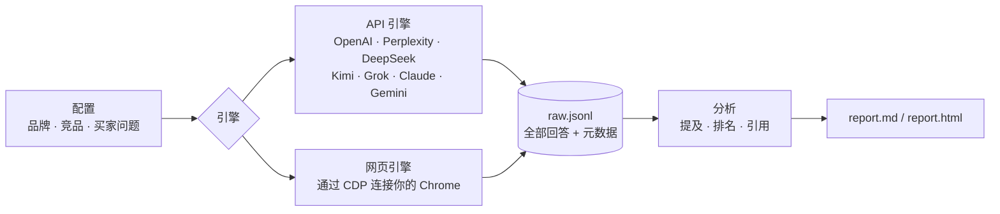

<div align="center">


# citeshine-audit

**一条命令，查清 ChatGPT、Perplexity、DeepSeek 这些 AI 推荐的是你，还是你的竞品。**

*让 AI 看见你 · Make AI see you*

[](LICENSE)
[](#快速上手)
[](#快速上手)

[English](README.md) · **简体中文** · [免费体检](https://citeshine.com) · [示例报告](docs/examples/citeshine-chatgpt-web-2026-10-13.md)

</div>

---

## 买家不再搜索了，他们直接问 AI

“做 X 用什么工具好？”这类问题，现在越来越多地交给 ChatGPT、Perplexity、DeepSeek、Kimi、Gemini。AI 只给几个名字，**名单里没有你，对这位买家来说你就不存在**。没有点击，没有访问，后台数据里什么也看不到。

大多数团队根本不知道 AI 是怎么介绍自己的。`citeshine-audit` 用买家真实会问的问题去问 AI，保存每一条回答，统计谁被提到、排第几、引用了谁。

### 我们先拿自己开刀

真实数据，第 0 天的基线（[完整报告](docs/examples/citeshine-chatgpt-web-2026-10-13.md)）：

- **0 / 11**：11 个通用买家问题（“靠谱的 GEO 服务商有哪些”“怎么监测品牌在 ChatGPT 里的曝光”等），ChatGPT 一次都没提到引耀。
- **被认错**：直接问引耀是谁，ChatGPT 把 citeshine.com 说成一家**卖手机壳的 Shopify 旧网店**，依据是 Merchant Genius 上这个域名前任主人的记录。

这就是这个工具能帮你看见的差距，也是我们自己的起点。之后的复测结果也会公开。

<p align="center"></p>

## 测什么

| 指标 | 说明 |
|---|---|
| **提及率** | 回答中提到品牌（名称、别名、域名）的比例，按引擎、按问题分别统计 |
| **推荐排名** | 在所有追踪品牌中第一次被提到的顺序，以及在列表里的位置 |
| **声量占比** | 你和每个竞品各被提到多少次 |
| **引用来源** | AI 引用了哪些域名，有没有引用你的官网 |
| **原始回答** | 每条回答连同时间、引擎、模型、问题存进 `raw.jsonl`，可以复现、可以审计 |

所有数字都是原始计数，附带样本量，不做外推。提到你的回答会全文引用，方便人工核对准确性。

## 支持的引擎

| 引擎 | 方式 | 状态 |
|---|---|---|
| `openai`、`perplexity`、`deepseek`、`kimi`、`grok`、`claude`、`gemini` | API，设置对应的环境变量 | 已实现，需要自备 Key |
| `chatgpt-web` | 网页版，连接你的 Chrome | **示例报告就是用它跑的**（未登录） |
| `perplexity-web`、`kimi-web` | 网页版，连接你的 Chrome | 实验性，需要已登录 |

网页引擎通过 `--remote-debugging-port` 连接你本机已打开的 Chrome（环境变量 `CITESHINE_CDP`，默认 `http://127.0.0.1:9226`），用的是你已登录的会话。它按人的节奏操作：单标签页、逐字输入、每个问题间隔 20 到 40 秒，遇到验证码或登录墙就停。网站改版时可能失效，请遵守各网站条款，控制频率。网页引擎需要先 `pip install playwright`。

## 快速上手

```bash
git clone https://github.com/Citeshine/citeshine-audit && cd citeshine-audit
python3 -m citeshine_audit --list-engines              # 查看哪些引擎可用
export DEEPSEEK_API_KEY=...                            # 你有的任意引擎 Key
python3 -m citeshine_audit configs/citeshine.json -n 3 # 跑所有有 Key 的引擎，每个问题 3 次
python3 -m citeshine_audit configs/citeshine.json --engines chatgpt-web -n 1 --prompts zh01,en01
python3 -m citeshine_audit configs/citeshine.json -o runs/x --report-only   # 用 raw.jsonl 重新生成报告
```

API 引擎只用 Python 标准库。结果输出到 `runs/<品牌>-<时间>/`，包括 `raw.jsonl`、`report.md` 和 `report.html`。

**测你自己的品牌**：复制 `configs/citeshine.json`，改掉 `brand`（名称、别名、域名、品类）、`competitors` 和 `prompts`（id、语言、问题文本）。问题要按买家的口吻写，你在哪些语言市场卖，就用哪些语言写。

## 工作原理



## 方法与局限

- 品牌匹配是对名称和别名做不区分大小写的子串匹配，别名不要选容易撞上普通词的。
- 未登录的网页回答和 API 回答、登录后的个性化回答都会不一样。报告时务必写明引擎、模式、日期和 n。
- ChatGPT 网页版的来源显示为小标签，所以 `chatgpt-web` 一般抓不到引用链接。
- 样本小，波动就大。只比较问题和引擎都相同的几次运行。

## 路线图

- [ ] 跑通需要登录的网页引擎：DeepSeek、豆包、元宝、Kimi、Perplexity
- [ ] 基线和复测的对比报告
- [ ] 自动标出过时或错误的品牌信息
- [ ] SaaS、AI 工具类目的问题模板
- [ ] 定时复测、导出 CSV

## 常见问题

**这是 SEO 吗？** 不是。SEO 管的是网页在搜索结果里的排名，GEO（生成式引擎优化）管的是 AI 回答里有没有点你的名、引你的站。这个工具测的是后者。

**为什么每次结果不一样？** 大模型的回答本身有随机性。用 `-n 3` 或更多，并且只比较同样的问题和引擎。

**能用登录的账号吗？** 网页引擎用的就是你 Chrome 里已登录的会话，账号信息不会离开你的浏览器。

**示例数据可信吗？** 那是一次小规模的真实运行（n=1，13 个问题），作为基线公开，不是行业基准。

**许可证？** MIT，随便用、随便改。

## 想出现在 AI 的答案里？

引耀帮中国 SaaS 和 AI 工具在海外市场被 AI 看见。

1. **免费 AI 可见度体检**：整理你的买家问题，测出各引擎上的基线，给出改进清单。
2. **月度基础费**：覆盖实施工作和每月复测。
3. **效果奖金**：只有复测达到双方书面约定的目标才支付。

👉 **[到 citeshine.com 免费体检](https://citeshine.com)** · ✉️ [hello@citeshine.com](mailto:hello@citeshine.com)

---

<div align="center"><sub>MIT © 引耀 Citeshine · 让 AI 看见你</sub></div>
