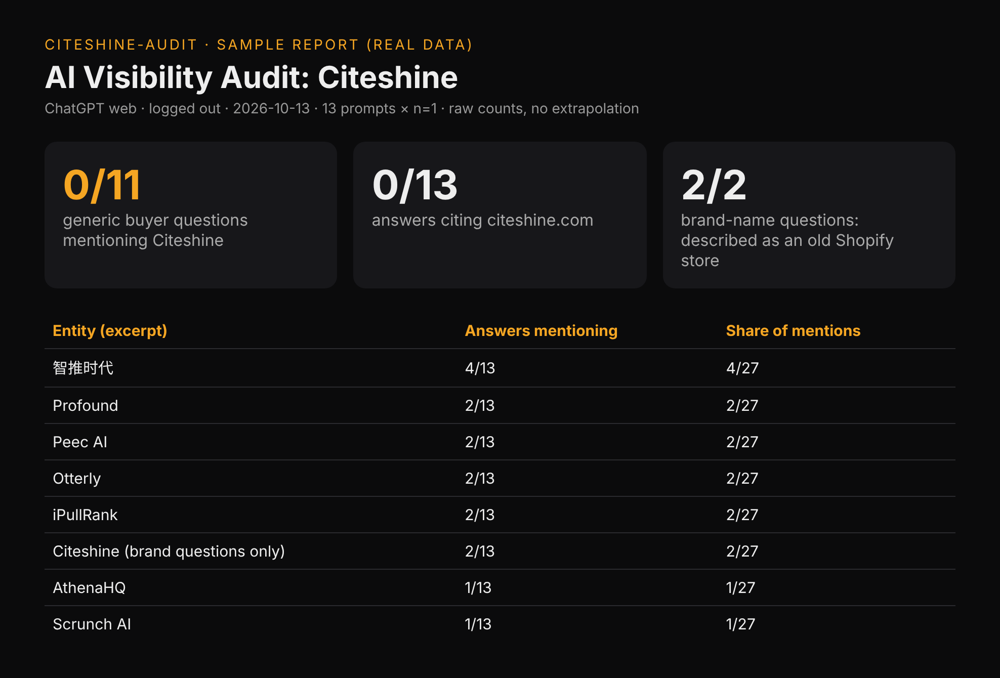
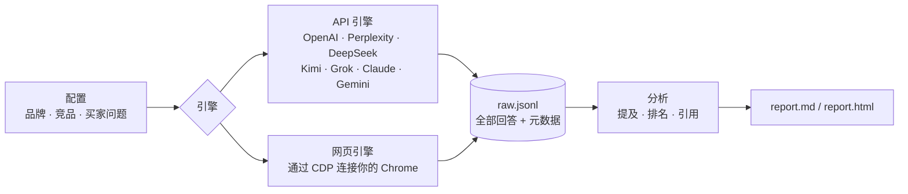

<div align="center">


# citeshine-audit

**ChatGPT 推荐的是你还是竞品？它怎么介绍你？一条命令查清。**

*让 AI 看见你 · Make AI see you*

[](LICENSE) [](#快速上手) [](#快速上手) [](#测什么)

[English](README.md) · **简体中文** · [免费体检](https://citeshine.com) · [示例报告](docs/examples/citeshine-chatgpt-web-2026-10-13.md)

</div>

---

## 买家不搜了，直接问 AI

“做 X 用哪个工具好？”这种问题，买家现在直接丢给 ChatGPT、Perplexity、DeepSeek、Kimi、Gemini。AI 只回几个名字。**名单上没有你，在这位买家眼里你就不存在。** 没有点击，没有访问，数据后台毫无痕迹。

更糟的是，AI 可能把你说错：旧产品、域名的上一任主人、早已解决的差评。AI 怎么介绍你？多数团队心里没底。`citeshine-audit` 替你用买家口吻发问，存下每条回答，统计谁被提到、谁排在前面、谁被引用。

### 先拿自己开刀

第 0 天，真实数据，不加修饰（[完整报告](docs/examples/citeshine-chatgpt-web-2026-10-13.md)）：

- **0 / 11。** 11 个通用买家问题（“靠谱的 GEO 服务商有哪些”“怎么监测品牌在 ChatGPT 里的曝光”……），ChatGPT 一次也没提到引耀。
- **认错人。** 直接问引耀是谁，ChatGPT 说 citeshine.com 是一家**卖手机壳的 Shopify 旧网店**，依据是 Merchant Genius 上这个域名的旧记录。

差距就摆在这里，这也是我们的起点。之后我们会用同一组问题复测引耀，每次结果都和第 0 天对照公开，变好变坏都发。

<p align="center"></p>

## 测什么

| 指标 | 说明 |
|---|---|
| **提及率** | 回答里提到你（名称、别名、域名）的比例，按引擎、按问题分开统计 |
| **推荐排名** | 在所有追踪品牌中第几个被提到，在列表里排第几 |
| **声量占比** | 你和每个竞品各被提到多少次 |
| **引用来源** | AI 引了哪些域名，有没有你的官网 |
| **原始回答** | 每条回答连同时间、引擎、模型、问题存进 `raw.jsonl`，可复现，可审计 |

所有数字都是原始计数，标明样本量，不做外推。提到你的回答，报告里会摘录原文，方便人工核对说得对不对；完整原文都在 `raw.jsonl`。

## 支持的引擎

| 引擎 | 方式 | 状态 |
|---|---|---|
| `openai`、`perplexity`、`deepseek`、`kimi`、`grok`、`claude`、`gemini` | API，设置对应环境变量（`--list-engines` 可查） | 已实现，未完整验证；自备 Key |
| `chatgpt-web` | 网页版，连接你的 Chrome | **公开报告只用这个引擎**（未登录） |
| `perplexity-web`、`kimi-web` | 网页版，连接你的 Chrome | 实验性，需先登录 |

我们的公开报告只用 `chatgpt-web`。API 引擎代码已经写好，但还没有完整跑通验证。

网页引擎连接你本机已开启 `--remote-debugging-port` 的 Chrome（环境变量 `CITESHINE_CDP`，默认 `http://127.0.0.1:9226`），直接用你已登录的会话。操作节奏像真人：单个标签页，逐字输入，两个问题间隔 20–40 秒；碰到验证码或登录墙立刻停下。网站一改版，选择器就可能失效。请遵守各网站条款，控制频率。网页引擎需先 `pip install playwright`。

## 快速上手

```bash
git clone https://github.com/Citeshine/citeshine-audit && cd citeshine-audit
python3 -m citeshine_audit --list-engines              # 列出各引擎，看 API Key 是否就绪

export DEEPSEEK_API_KEY=...                            # 手上有哪个引擎的 Key 都行
python3 -m citeshine_audit configs/citeshine.json -n 3 # 跑所有有 Key 的引擎，每个问题 3 次
python3 -m citeshine_audit configs/citeshine.json --engines deepseek,perplexity:sonar-pro -o runs/x
python3 -m citeshine_audit configs/citeshine.json --engines chatgpt-web -n 1 --prompts zh01,en01
python3 -m citeshine_audit configs/citeshine.json -o runs/x --report-only   # 用 raw.jsonl 重新生成报告
```

API 引擎只依赖 Python 标准库。结果写入 `runs/<品牌>-<时间>/`：`raw.jsonl`、`report.md`、`report.html`。

**测你自己的品牌：** 复制 `configs/citeshine.json`，改 `brand`（名称、别名、域名、品类）、`competitors` 和 `prompts`（id、语言、问题）。问题照买家口吻写；在哪些语言市场卖，就用哪些语言问。

## 工作原理



## 方法与局限

- 品牌匹配：对名称和别名做不区分大小写的子串匹配。别名别选容易撞上常用词的。
- 未登录网页版、API、登录后个性化回答，三者结果各不相同。发布数据时务必注明引擎、模式、日期和 n。
- ChatGPT 网页版把来源显示成小标签，所以 `chatgpt-web` 通常抓不到引用链接。
- n 越小，波动越大。只拿问题和引擎都相同的运行做对比。

## 路线图

- [ ] 跑通需要登录的网页引擎：DeepSeek、豆包、元宝、Kimi、Perplexity
- [ ] 基线与复测对比报告
- [ ] 自动标出过时或错误的品牌信息
- [ ] SaaS、AI 工具类目问题模板
- [ ] 定时复测，导出 CSV

## 常见问题

**这是 SEO 吗？** 不是。SEO 争的是搜索结果里的排名；GEO（生成式引擎优化）争的是 AI 回答里有没有点你的名、引你的站。这个工具测后者。

**为什么每次结果不一样？** 大模型回答本身带随机性。用 `-n 3` 或更多次，只做同条件对比。

**能用登录账号吗？** 网页引擎直接用你 Chrome 里已登录的会话，账号凭据不出你的浏览器。

**示例数据靠得住吗？** 那是一次小规模真实运行（n=1，13 个问题），作为基线公开，不是行业基准。

**许可证？** MIT。随便用，随便改，拿去发布。

## 想进 AI 的推荐名单？

引耀服务做海外市场的中国 SaaS 和 AI 工具团队：让 AI 推荐你，也纠正 AI 对你的错误描述。服务测试 ChatGPT、Perplexity、Gemini，也测试 DeepSeek、豆包、Kimi。本开源工具目前只有 `chatgpt-web` 跑出过公开报告；DeepSeek、豆包、Kimi、Perplexity 的登录网页版已列入[路线图](#路线图)。

1. **免费 AI 可见度体检**：梳理你的买家问题，测出各引擎基线，给一份改进清单。
2. **月度基础费**：覆盖落地实施和每月复测。
3. **效果奖金**：复测达到双方书面约定的目标，才付这笔钱。

👉 **[到 citeshine.com 免费体检](https://citeshine.com)** · ✉️ [hello@citeshine.com](mailto:hello@citeshine.com)

---

<div align="center"><sub>MIT © 引耀 Citeshine · 让 AI 看见你</sub></div>
